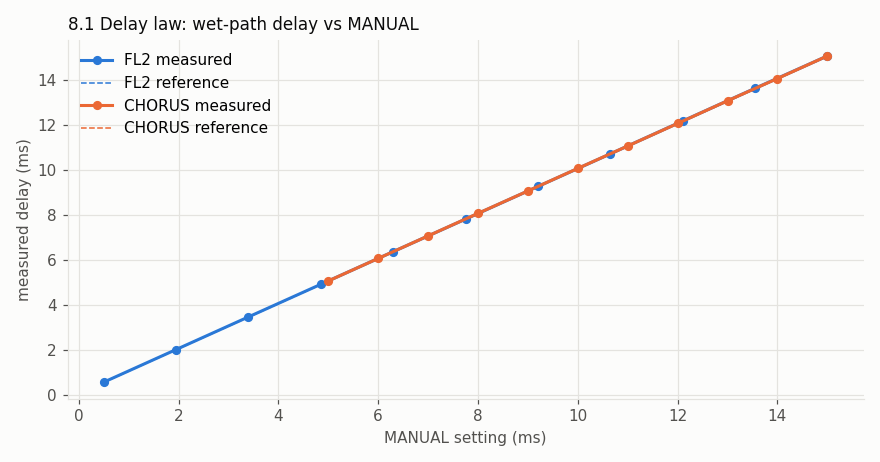
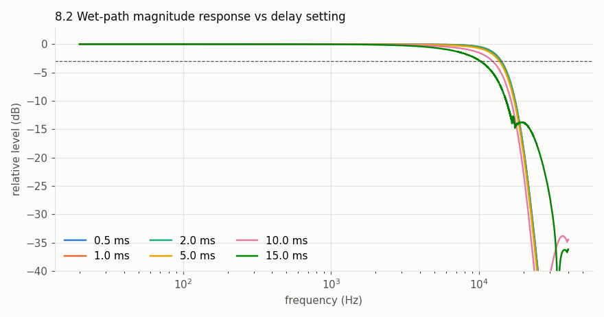
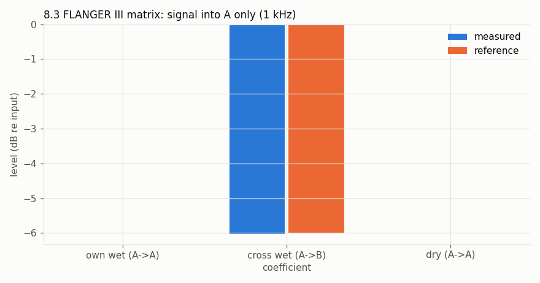
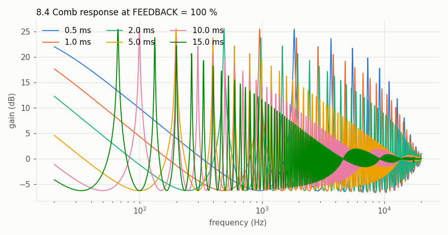
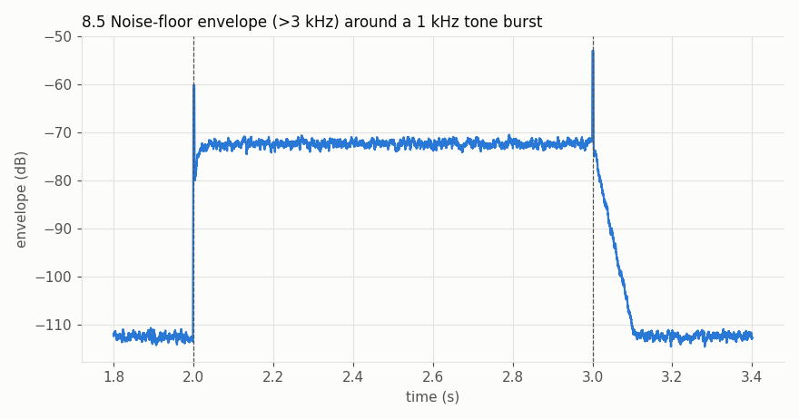
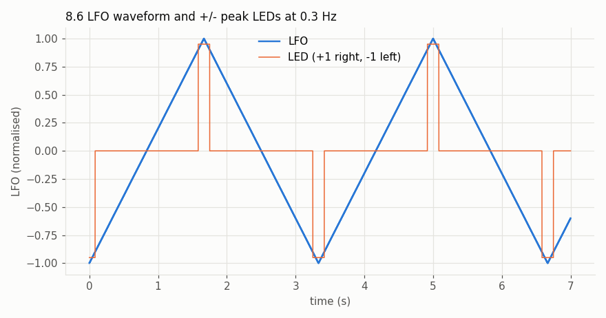
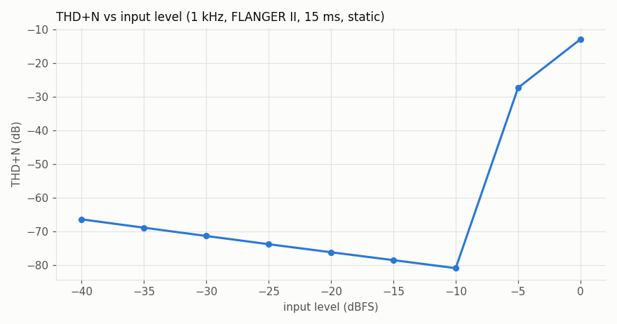
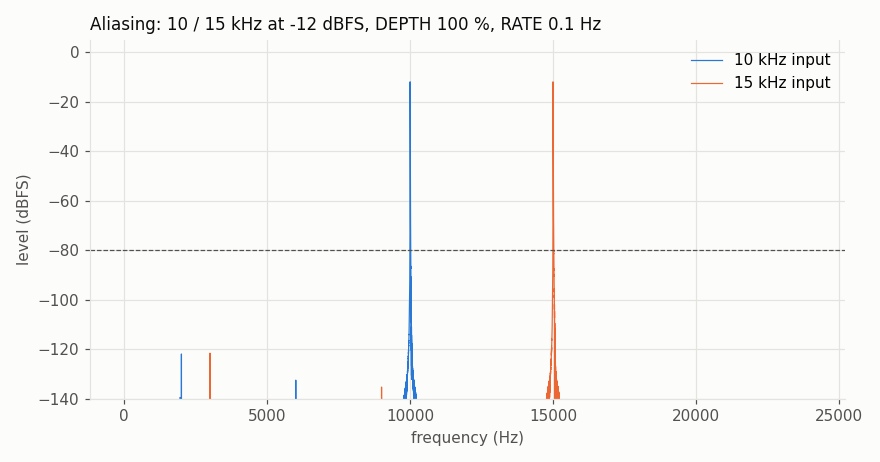
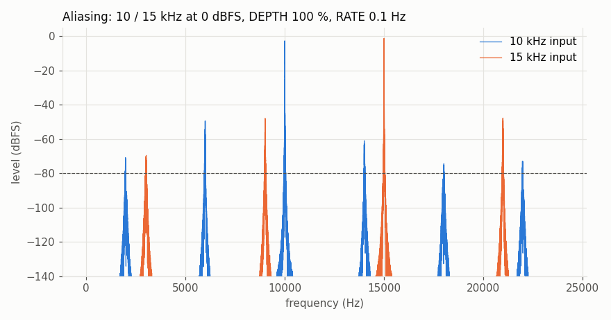
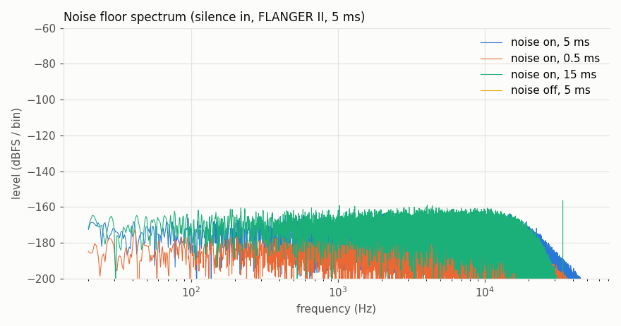

# Measured results

Generated 2026-11-07T20:47:09 on macOS-26.6.2-arm64-arm-64bit at 96000 Hz by `measure/run_all.py`.
Reference: **none** - gates compare the model against its own declared constants and the published specifications; no reference unit was measured.

| Test | Gate | Result |
|---|---|---|
| 8.1 delay law | worst error <= 3 % of reading | **PASS** |
| 8.2 bandwidth law | -3 dB point within +-10 % of reference | **PASS** |
| 8.3 mode matrix | own/cross/dry within 0.5 dB | **PASS** |
| 8.4 feedback ceiling | no self-oscillation at 100 %; comb peak within 1 dB of hardware | **PASS** |
| 8.5 compander | release tau within 20 % of reference; attack settles | **PASS** |
| 8.6 LFO | rate within 5 %; triangle; LEDs at peaks | **PASS** |
| THD+N sweep | finite; THD+N at -20 dBFS <= -50 dB (hardware curve when available) | **PASS** |
| aliasing | products below the tone <= -80 dBFS at -12 dBFS input; 0 dBFS reported | **PASS** |
| noise floor | < -70 dBm (-90 dBFS) with noise on; < -120 dBFS off | **PASS** |
| null test | residual < -30 dB | skipped |
| CPU / latency | informational CPU; latency reported exactly | **PASS** |

## 8.1 delay law

**points**

| mode | manual_ms | measured_us | expected_us | error_pct |
|---|---|---|---|---|
| fl2 | 0.5 | 550.1 | 540.8 | 1.715 |
| fl2 | 1.95 | 2001 | 1991 | 0.527 |
| fl2 | 3.4 | 3454 | 3441 | 0.375 |
| fl2 | 4.85 | 4904 | 4891 | 0.261 |
| fl2 | 6.3 | 6356 | 6341 | 0.247 |
| fl2 | 7.75 | 7804 | 7791 | 0.167 |
| fl2 | 9.2 | 9256 | 9241 | 0.16 |
| fl2 | 10.65 | 1.071e+04 | 1.069e+04 | 0.139 |
| fl2 | 12.1 | 1.217e+04 | 1.214e+04 | 0.222 |
| fl2 | 13.55 | 1.362e+04 | 1.359e+04 | 0.233 |
| fl2 | 15 | 1.506e+04 | 1.504e+04 | 0.142 |
| chorus | 5 | 5053 | 5041 | 0.252 |
| chorus | 6 | 6055 | 6041 | 0.236 |
| chorus | 7 | 7058 | 7041 | 0.248 |
| chorus | 8 | 8061 | 8041 | 0.247 |
| chorus | 9 | 9058 | 9041 | 0.185 |
| chorus | 10 | 1.006e+04 | 1.004e+04 | 0.201 |
| chorus | 11 | 1.106e+04 | 1.104e+04 | 0.156 |
| chorus | 12 | 1.206e+04 | 1.204e+04 | 0.163 |
| chorus | 13 | 1.307e+04 | 1.304e+04 | 0.218 |
| chorus | 14 | 1.406e+04 | 1.404e+04 | 0.135 |
| chorus | 15 | 1.506e+04 | 1.504e+04 | 0.142 |

**worst_error_pct**: 1.715

**reference**: model nominal (no hardware captures)

## 8.2 bandwidth law

no hardware captures: gating the 0.5 ms setting against the published 14 kHz (+-10 %); got 14140 Hz

**settings**

| manual_ms | f3db_hz | ref_hz |
|---|---|---|
| 0.5 | 1.414e+04 | None |
| 1 | 1.413e+04 | None |
| 2 | 1.407e+04 | None |
| 5 | 1.371e+04 | None |
| 10 | 1.235e+04 | None |
| 15 | 1.023e+04 | None |

## 8.3 mode matrix

**measured**: own_db = -0.003, cross_db = -6.023, dry_db = 0, dry_leak_to_B_db = -600, cross_sign = -1, fl2_B_leak_db = -600, fl1_output_difference = 0

**expected_db**: own = 0, cross = -6.021, dry = 0

**errors_db**: own = 0.003, cross = 0.003, dry = 0

**reference**: declared tunables

## 8.4 feedback ceiling

**settings**

| manual_ms | tail_dbfs | during_dbfs | peak_abs | decays | max_comb_peak_db | peak_at_hz |
|---|---|---|---|---|---|---|
| 0.5 | -137.2 | -21.2 | 0.251 | True | 25.46 | 1830 |
| 1 | -133.4 | -3.8 | 0.998 | True | 25.5 | 955.2 |
| 2 | -130.7 | -4 | 0.999 | True | 25.52 | 488.3 |
| 5 | -127.5 | -4.5 | 0.999 | True | 25.53 | 198 |
| 10 | -103.6 | -4.9 | 0.998 | True | 25.59 | 99.4 |
| 15 | -75.6 | -6.1 | 0.995 | True | 25.44 | 66.4 |

**reference**: none (decay gate only)

## 8.5 compander

**attack_settle_3db_ms**: 0

**release_tau_ms**: 24.21

**expected_attack_ms**: 66

**expected_release_tau_ms**: 22

**attack_err_pct**: 0

**release_err_pct**: 10.1

**noise_with_tone_db**: -72.4

**noise_without_tone_db**: -112.3

**reference**: model tau = 22 ms

## 8.6 LFO

**rates**

| rate_hz | measured_hz | error_pct | triangle_corr | sine_corr | led_at_peak | led_on_fraction |
|---|---|---|---|---|---|---|
| 0.02 | 0.02 | 0 | 1 | 0.9908 | True | 0.05 |
| 0.3 | 0.3 | 0 | 1 | 0.9909 | True | 0.05 |
| 5 | 5 | 0 | 0.9999 | 0.9913 | True | 0.05 |

**waveform**: triangle

## THD+N sweep

**levels**

| level_dbfs | thdn_db | ref_db |
|---|---|---|
| -40 | -66.49 | None |
| -35 | -68.97 | None |
| -30 | -71.44 | None |
| -25 | -73.88 | None |
| -20 | -76.28 | None |
| -15 | -78.62 | None |
| -10 | -81.01 | None |
| -5 | -27.39 | None |
| 0 | -12.97 | None |

**reference**: none (informational)

## aliasing

**cases**

| input_dbfs | tone_hz | worst_alias_dbfs | at_hz |
|---|---|---|---|
| -12 | 10000 | -121.9 | 2000 |
| -12 | 15000 | -121.6 | 3001 |
| 0 | 10000 | -49.4 | 5990 |
| 0 | 15000 | -48 | 9010 |

## noise floor

**cases**

| noise | manual_ms | rms_dbfs | rms_dbm |
|---|---|---|---|
| on | 5 | -135.5 | -115.5 |
| on | 0.5 | -145.3 | -125.3 |
| on | 15 | -131.6 | -111.6 |
| off | 5 | -600 | -580 |

## null test

no reference captures under --reference; skipped

## CPU / latency

**cpu_48k_64**

| mode | manual_ms | cpu_percent |
|---|---|---|
| fl1 | 2 | 1.87 |
| fl2 | 2 | 3.62 |
| fl3 | 2 | 3.63 |
| chorus | 10 | 2.39 |
| fl2 | 0.5 | 5.32 |

**latency_samples**: 4

**latency_note**: 0 algorithmic; 4 samples oversampling (half-band up/down round trip), reported to the host
